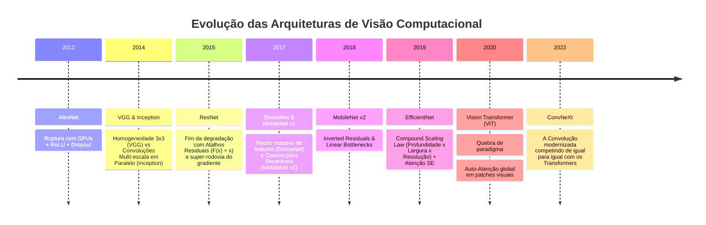

# 🧠 Estudo da Evolução das Arquiteturas de CNN e Vision Transformers em Raio-X de Tórax

Este repositório é um **projeto didático completo voltado para salas de aula, laboratórios acadêmicos e pesquisadores**, dedicado ao estudo prático e teórico da evolução histórica da Visão Computacional aplicada à **classificação binária de exames médicos de Raio-X de Tórax**.

---

## 📚 Documentação Didática por Modelo (`docs/`)

Em vez de concentrar todos os detalhes teóricos em um único arquivo, criamos uma pasta [`docs/`](docs/). Cada modelo possui um documento dedicado com contexto histórico, fórmulas matemáticas, rastreamento de tensores (*tensor shapes*), referências diretas ao código-fonte em [`models/`](models/) e considerações clínicas:

| # | Arquitetura | Ano | Paradigma Principal | Guia Didático Detalhado | Código-Fonte |
| :-: | :--- | :-: | :--- | :--- | :--- |
| **1** | **AlexNet** | 2012 | Ruptura com GPU + ReLU + Dropout | [📖 `docs/alexnet.md`](docs/alexnet.md) | [`models/alexnet.py`](models/alexnet.py) |
| **2** | **VGG** | 2014 | Homogeneidade e fatoração de campo $3 \times 3$ | [📖 `docs/vgg.md`](docs/vgg.md) | [`models/vgg.py`](models/vgg.py) |
| **3** | **Inception** | 2014 | Convoluções multi-escala em paralelo | [📖 `docs/inception.md`](docs/inception.md) | [`models/inception.py`](models/inception.py) |
| **4** | **ResNet** | 2015 | Conexões residuais aditivas ($F(x) + x$) | [📖 `docs/resnet.md`](docs/resnet.md) | [`models/resnet.py`](models/resnet.py) |
| **5** | **DenseNet** | 2017 | Concatenação total e reuso de features ($k=32$) | [📖 `docs/densenet.md`](docs/densenet.md) | [`models/densenet.py`](models/densenet.py) |
| **6** | **MobileNet** | 2017/18 | Convoluções separáveis e resíduos invertidos | [📖 `docs/mobilenet.md`](docs/mobilenet.md) | [`models/mobilenet.py`](models/mobilenet.py) |
| **7** | **EfficientNet** | 2019 | Escalonamento composto + Atenção SE | [📖 `docs/efficientnet.md`](docs/efficientnet.md) | [`models/efficientnet.py`](models/efficientnet.py) |
| **8** | **Vision Transformer** | 2020 | Auto-Atenção pura em patches de imagem | [📖 `docs/vision_transformer.md`](docs/vision_transformer.md) | [`models/vision_transformer.py`](models/vision_transformer.py) |
| **9** | **ConvNeXt** | 2022 | A Convolução modernizada para os anos 2020 | [📖 `docs/convnext.md`](docs/convnext.md) | [`models/convnext.py`](models/convnext.py) |

---

## ⏳ Linha do Tempo e Evolução dos Paradigmas



---

## 📁 Estrutura do Projeto

```text
estudando_cnns/
├── docs/                           # 📖 Documentação didática aprofundada por arquitetura
│   ├── alexnet.md                  # Análise teórica e dissecação de código da AlexNet
│   ├── vgg.md                      # Estudo de campo receptivo e blocos VGG
│   ├── resnet.md                   # Resíduos, gradientes e blocos BasicBlock/Bottleneck
│   ├── densenet.md                 # Concatenação, taxa de crescimento e transições
│   ├── inception.md                # Convoluções multi-escala e bottlenecks 1x1
│   ├── mobilenet.md                # Convoluções separáveis e gargalos lineares
│   ├── efficientnet.md             # Escalonamento composto e blocos MBConv com SE
│   ├── vision_transformer.md       # Patches, token [CLS] e auto-atenção multi-cabeça
│   └── convnext.md                 # Modernização da convolução para a década de 2020
├── models/                         # 📦 Pacote com as implementações artesanais puras
│   ├── __init__.py                 # Exportações centrais de classes e builders
│   ├── alexnet.py                  # Classe AlexNet
│   ├── vgg.py                      # Classes VGG e VGGBlock
│   ├── resnet.py                   # Classes ResNet, BasicBlock e Bottleneck
│   ├── densenet.py                 # Classes DenseNet, DenseBlock e TransitionLayer
│   ├── inception.py                # Classes InceptionNet e InceptionBlock
│   ├── mobilenet.py                # Classes MobileNetV1 e MobileNetV2
│   ├── efficientnet.py             # Classes EfficientNet, MBConvBlock e SqueezeExcitation
│   ├── vision_transformer.py       # Classes VisionTransformer e MultiHeadSelfAttention
│   ├── convnext.py                 # Classes ConvNeXt e ConvNeXtBlock
│   └── factory.py                  # Fábrica flexível: get_model() (Classes puras vs timm)
├── model_factory.py                # Ponte de compatibilidade retroativa
├── models_class.py                 # Helper explicativo timm vs didático
├── generator.py                    # Dataset PyTorch (ChestXRayDataset) e augmentations médicas
├── utils.py                        # Prevenção de vazamento por paciente (StratifiedGroupKFold)
├── config.py                       # Configurações globais, hiperparâmetros e seleção do modelo
├── main.py                         # Pipeline didático completo de treinamento e validação
└── README.md                       # Hub principal e índice de documentação
```

---

## 🛠️ Como Usar no Código

O projeto foi refatorado para permitir que os alunos e pesquisadores escolham entre **duas formas de instanciar os modelos**:

### Opção 1: Importação Direta da Classe do Arquivo (Modo Sala de Aula)
Ideal para inspecionar parâmetros, imprimir `print(model)` e testar tensores:

```python
import torch
from models.alexnet import AlexNet
from models.resnet import ResNet18
from models.densenet import DenseNet121
from models.convnext import ConvNeXt

# Instancia a classe escrita artesanalmente em PyTorch puro:
model = ResNet18(num_classes=1, in_channels=3)

# Teste com um lote fictício de 2 radiografias [Batch, Canais, Altura, Largura]
x = torch.randn(2, 3, 224, 224)
output = model(x)
print(output.shape)  # torch.Size([2, 1]) (logits para classificação binária)
```

### Opção 2: Via Factory Unificada (`get_model`)
Permite alternar entre o modo didático e o modo pré-treinado da biblioteca `timm`:

```python
from models.factory import get_model

# 1. Modo Didático Puro (instancia nossa classe em models/ sem bibliotecas externas):
model_didatico = get_model('convnext_tiny', num_classes=1, use_timm=False)

# 2. Modo timm com pesos pré-treinados no ImageNet (para Transfer Learning médico):
model_timm = get_model('resnet50', num_classes=1, use_timm=True, pretrained=True)
```

---

## 🩺 Cuidados Metodológicos em Imagens Médicas (Raio-X de Tórax)

1. **Prevenção de Vazamento por Paciente (*Patient Data Leakage*):**
   - Implementado em [`utils.py`](utils.py) via `StratifiedGroupKFold(groups=df['COPA_PACI_ID'])`.
   - Se um paciente tem múltiplos exames, todos eles ficam restritos **ou** ao conjunto de treino **ou** ao conjunto de teste. Isso impede que a rede memorize a anatomia particular de um indivíduo em vez de aprender a patologia geral.
2. **Desbalanceamento Clínico de Classes:**
   - Em radiologia, exames normais costumam ser muito mais numerosos que exames com patologias específicas.
   - Em [`main.py`](main.py), calculamos dinamicamente `pos_weight = neg_count / pos_count`, balanceando os gradientes da função `nn.BCEWithLogitsLoss`.
3. **Data Augmentation Clinicamente Plausível:**
   - Em [`generator.py`](generator.py), são permitidas pequenas rotações e variações de escala, mas **são proibidos flips verticais** (pacientes não ficam de cabeça para baixo) e flips horizontais excessivos (o coração situa-se naturalmente à esquerda).
