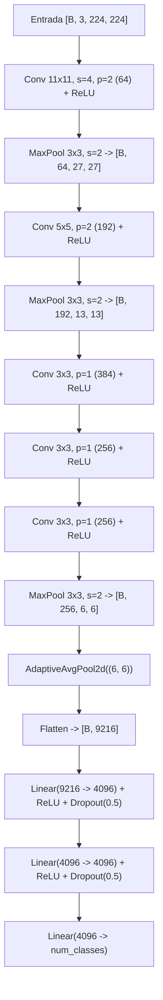

# 🧠 AlexNet (2012) — O Marco Zero do Deep Learning Moderno

> **Artigo Original:** *ImageNet Classification with Deep Convolutional Neural Networks*  
> **Autores:** Alex Krizhevsky, Ilya Sutskever, Geoffrey E. Hinton (Universidade de Toronto)  
> **Conferência:** NeurIPS 2012  
> **Código Didático:** [`models/alexnet.py`](../models/alexnet.py)

---

## 1. Contexto Histórico e O Problema

Até o ano de 2012, o estado da arte em Visão Computacional dependia quase inteiramente de **engenharia de atributos manuais** (*handcrafted features*), como SIFT, SURF e HOG, combinados com classificadores rasos, como Máquinas de Vetores de Suporte (SVMs). 

Esse paradigma apresentava dois gargalos intransponíveis:
1. **Fragrância dos Atributos Manuais:** Especialistas humanos precisavam definir regras heurísticas para o que constituía uma borda, textura ou canto. Essas regras falhavam diante de variações de iluminação, pose e oclusão.
2. **Capacidade Computacional Limitada:** Redes neurais convolucionais profundas já haviam sido propostas na década de 1990 (como a LeNet-5 de Yann LeCun), mas eram computacionalmente caras demais para treinar em conjuntos massivos de dados utilizando CPUs convencionais.

No desafio do **ImageNet (ILSVRC 2012)**, contendo mais de 1.2 milhão de imagens distribuídas em 1.000 classes, a **AlexNet** venceu com um erro *top-5* de **15.3%**, superando o segundo colocado (que utilizava métodos clássicos com 26.2%) por uma margem histórica de mais de 10 pontos percentuais. Esse momento marcou o renascimento oficial do Deep Learning.

---

## 2. Inovações Conceituais Fundamentais

A AlexNet introduziu quatro pilares que se tornaram a base de quase todas as arquiteturas modernas:

### 2.1 A Função de Ativação ReLU
Historicamente, utilizavam-se funções saturantes como a Sigmoide ou Tangente Hiperbólica ($\tanh$):
$$\sigma(x) = \frac{1}{1 + e^{-x}}, \quad \tanh(x) = \frac{e^x - e^{-x}}{e^x + e^{-x}}$$

Quando os valores de entrada tornam-se moderadamente grandes ou pequenos, a derivada dessas funções tende a zero ($\frac{d\sigma}{dx} \to 0$). Esse fenômeno, conhecido como **Desvanecimento de Gradiente (*Vanishing Gradient*)**, impedia que as camadas iniciais aprendessem.

A AlexNet popularizou a **ReLU (*Rectified Linear Unit*)**:
$$f(x) = \max(0, x)$$

```text
Ativação ReLU:
       f(x)
        ^
        |       /
        |      /
        |     /
--------+----> x
        0
```

Por ter derivada constante igual a $1$ para qualquer valor positivo ($x > 0$), a ReLU não satura, permitindo que o gradiente flua sem atenuação e acelerando o treinamento via SGD em até **6 vezes**.

### 2.2 Regularização por Dropout ($p = 0.5$)
As camadas totalmente conectadas (*Fully Connected*) finais da AlexNet continham dezenas de milhões de pesos, gerando alto risco de *overfitting*. Para mitigar isso, introduziu-se o **Dropout**: a cada iteração de treino, 50% dos neurônios são desligados aleatoriamente com probabilidade $p=0.5$. Isso impede que neurônios específicos dependam excessivamente da presença de outros, forçando a rede a aprender representações redundantes e robustas.

### 2.3 Kernels Grandes Iniciais ($11 \times 11$) com Stride 4
Em 2012, os recursos de memória de GPU eram severamente restritos (GPUs de 3 GB de VRAM). Para processar imagens de $224 \times 224$ pixels sem esgotar a memória, a primeira convolução precisava aplicar um filtro amplo ($11 \times 11$) com passo grande ($\text{stride} = 4$), comprimindo a resolução espacial de $224 \times 224$ para $55 \times 55$ logo na largada.

### 2.4 Max Pooling com Sobreposição (*Overlapping Pooling*)
Em vez de janelas convencionais de $2 \times 2$ com $\text{stride} = 2$ (sem sobreposição), a AlexNet utilizou janelas de tamanho $3 \times 3$ com $\text{stride} = 2$. Os autores observaram que janelas sobrepostas reduziram o erro de teste e tornaram o modelo ligeiramente menos propenso a memorizar ruído espacial.

---

## 3. Dissecando o Código em `models/alexnet.py`

A implementação didática em [`models/alexnet.py`](../models/alexnet.py) divide a rede em dois blocos transparentes: o extrator de características convolucionais (`features`) e o cabeçote classificador denso (`classifier`).



### 3.1 Rastreamento do Fluxo de Tensores (*Tensor Shapes*)

Abaixo ilustramos como as dimensões de um tensor evoluem ao passar pela classe `AlexNet` (considerando entrada padrão $[B, 3, 224, 224]$):

1. **Entrada:** `x` com formato `[B, 3, 224, 224]`
2. **Camada 1 (Conv 11x11, stride 4, padding 2):**
   $$H_{out} = \left\lfloor \frac{224 - 11 + 2 \times 2}{4} \right\rfloor + 1 = 55$$
   Saída: `[B, 64, 55, 55]` $\to$ após `MaxPool2d(3, stride=2)`: `[B, 64, 27, 27]`.
3. **Camada 2 (Conv 5x5, padding 2):**
   Saída: `[B, 192, 27, 27]` $\to$ após `MaxPool2d(3, stride=2)`: `[B, 192, 13, 13]`.
4. **Camadas 3, 4 e 5 (Convoluções 3x3 profundas):**
   - Conv3: `[B, 384, 13, 13]`
   - Conv4: `[B, 256, 13, 13]`
   - Conv5: `[B, 256, 13, 13]` $\to$ após `MaxPool2d(3, stride=2)`: `[B, 256, 6, 6]`.
5. **Classificador MLP:**
   - O pooling adaptativo fixa a grade em $6 \times 6$.
   - O achatamento (`flatten`) produz um vetor 1D por amostra: $256 \times 6 \times 6 = 9.216$ elementos.
   - O vetor passa por duas camadas de $4.096$ neurônios com Dropout e finaliza na projeção `num_classes` (1 para classificação binária).

---

## 4. Relevância em Raio-X de Tórax

Quando aplicamos a AlexNet na detecção de patologias pulmonares (ex: Pneumonia ou Derrame Pleural):
- **O que a rede enxerga nas primeiras camadas:** Filtros grandes de $11 \times 11$ agem como detectores grosseiros de orientação e densidade radiológica — eles separam claramente a transparência pulmonar (ar escuro) do arcabouço ósseo costal e da silhueta cardíaca (cálcio e tecidos moles brilhantes).
- **Limitação Crítica:** Por possuir mais de 60 milhões de parâmetros (a grande maioria concentrada nas camadas densas finais $9216 \to 4096 \to 4096$), a AlexNet apresenta uma tendência severa de memorizar o ruído de datasets médicos pequenos. Ela serve como um excelente modelo didático para demonstrar a necessidade de técnicas modernas de regularização e de redução de parâmetros.

---

## 5. Como Instanciar e Testar

```python
import torch
from models.alexnet import AlexNet, alexnet

# 1. Instanciação direta da classe
model = alexnet(num_classes=1, in_channels=3, dropout=0.5)

# 2. Simulação de um lote de 4 radiografias de tórax [Batch, Canais, Altura, Largura]
batch_xray = torch.randn(4, 3, 224, 224)

# 3. Inferência (Forward Pass)
logits = model(batch_xray)

print("Formato da saída (Logits):", logits.shape)  # torch.Size([4, 1])
probabilidades = torch.sigmoid(logits)
print("Probabilidade da patologia:", probabilidades)
```
