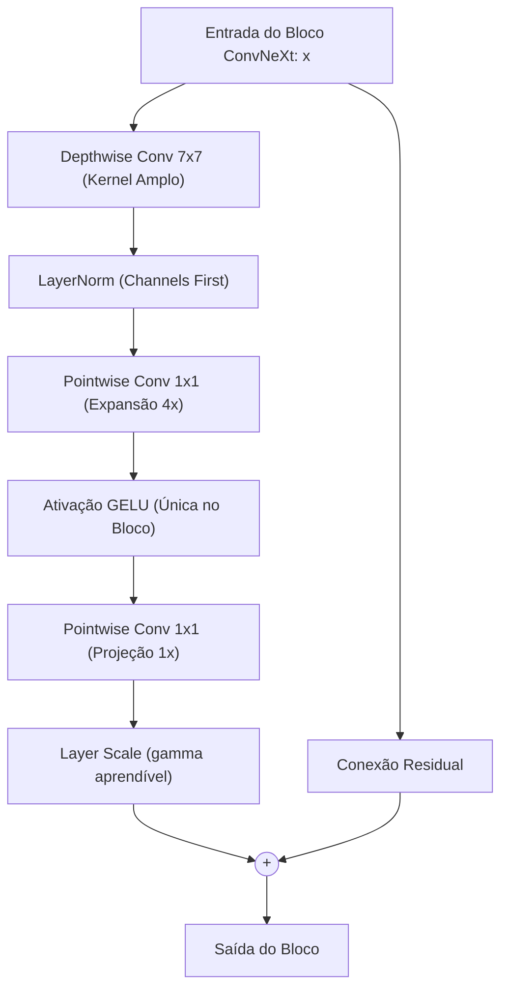

# 🔄 ConvNeXt (2022) — A Convolução Modernizada para os Anos 2020

> **Artigo Original:** *A ConvNet for the 2020s*  
> **Autores:** Zhuang Liu, Hanzi Mao, Chao-Yuan Wu, Christoph Feichtenhofer, Trevor Darrell, Saining Xie (Meta AI Research / UC Berkeley)  
> **Conferência:** CVPR 2022  
> **Código Didático:** [`models/convnext.py`](../models/convnext.py)

---

## 1. Contexto Histórico e A Pergunta Provocativa

Por volta de 2021, com a consolidação dos Vision Transformers (ViT, DeiT, Swin Transformer) no topo de todos os rankings de visão computacional, espalhou-se a percepção de que as Redes Neurais Convolucionais haviam atingido seu limite e estavam obsoletas.

No entanto, pesquisadores da Meta AI propuseram uma pergunta científica fundamental:
> *"O sucesso esmagador dos Vision Transformers veio do mecanismo de auto-atenção em si ou das inovações modernas de design macro/micro e técnicas avançadas de treinamento desenvolvidas na última década?"*

Para responder a essa pergunta, eles conduziram um experimento fascinante: pegaram uma clássica **ResNet-50 de 2015** e a modificaram **passo a passo** incorporando os conceitos dos Transformers, **sem utilizar absolutamente nenhuma camada de atenção**.

---

## 2. A "Modernização" da Convolução Passo a Passo



### 2.1 Macro Design
1. **Ajuste na Proporção de Estágios:**
   A ResNet-50 usava a proporção de blocos $(3, 4, 6, 3)$ (proporção $1:1:3:1$). A ConvNeXt adotou $(3, 3, 9, 3)$, a exata mesma distribuição com estágio intermediário longo utilizada pelo Swin Transformer.
2. **Stem com "Patchify":**
   A ResNet começava com uma convolução agressiva $7 \times 7$ com stride 2 seguida de MaxPool. A ConvNeXt substituiu isso por uma convolução $4 \times 4$ com stride 4 sem sobreposição, dividindo a imagem diretamente em patches de $4 \times 4$, idêntico ao processo dos Transformers visuais.

### 2.2 Inverted Bottleneck (Gargalo Invertido)
No bloco residual tradicional da ResNet, os canais começam largos, comprimem no meio e expandem ao final. Na ConvNeXt, os canais **expandem $4\times$ no meio do bloco** e depois projetam de volta para a dimensão original, mimetizando a camada MLP dos blocos Transformer.

### 2.3 Kernels Grandes ($7 \times 7$ Depthwise)
Para mimetizar o campo receptivo amplo das janelas de atenção, a ConvNeXt moveu uma convolução **Depthwise $7 \times 7$** para o início do bloco, expandindo a área de contexto local antes das transformações de canal.

### 2.4 Micro Design Refinado
1. **Substituição de ReLU por GELU:**
   Adota a função de ativação suave Gaussiana (GELU), padrão nos Transformers modernos.
2. **Menos Ativações e Menos Normalizações:**
   A ResNet tradicional aplicava BatchNorm e ReLU após cada uma das três convoluções do bloco. A ConvNeXt reduziu isso para **apenas uma ativação GELU** e **apenas uma camada de normalização** por bloco.
3. **Substituição de BatchNorm por LayerNorm:**
   A BatchNorm depende das estatísticas do batch de imagens, causando discrepâncias entre treino e teste quando o batch size é pequeno (muito comum em imagens médicas). A ConvNeXt adotou a **LayerNorm**, calculando a média e desvio padrão diretamente sobre os canais da amostra individual.
4. **Camadas Dedicadas de Downsampling:**
   Convoluções $2 \times 2$ com stride 2 acompanhadas de LayerNorm são inseridas entre os estágios para redução espacial controlada.

---

## 3. Dissecando o Código em `models/convnext.py`

O arquivo [`models/convnext.py`](../models/convnext.py) detalha essa construção:

### 3.1 LayerNorm Adaptada para Imagens (`LayerNormChannelsFirst`)
No PyTorch padrão, `nn.LayerNorm` atua sobre a última dimensão (`channels_last`). Como CNNs trabalham no formato `[B, C, H, W]`, a classe [`LayerNormChannelsFirst`](../models/convnext.py#L42-L60) normaliza eficientemente sobre a dimensão de canais:

```python
# Trecho de models/convnext.py:
class LayerNormChannelsFirst(nn.Module):
    def forward(self, x: torch.Tensor) -> torch.Tensor:
        u = x.mean(1, keepdim=True)
        s = (x - u).pow(2).mean(1, keepdim=True)
        x = (x - u) / torch.sqrt(s + self.eps)
        return self.weight[:, None, None] * x + self.bias[:, None, None]
```

### 3.2 O Bloco `ConvNeXtBlock`
O bloco [`ConvNeXtBlock`](../models/convnext.py#L62-L104) implementa o fluxo moderno com `Layer Scale` (fator multiplicador aprendível `gamma`):

```python
# Trecho didático de models/convnext.py:
def forward(self, x: torch.Tensor) -> torch.Tensor:
    input_res = x

    out = self.dwconv(x)      # 1. Depthwise 7x7
    out = self.norm(out)        # 2. LayerNorm
    out = self.pwconv1(out)     # 3. 1x1 expande 4x
    out = self.act(out)         # 4. Única ativação GELU
    out = self.pwconv2(out)     # 5. 1x1 projeta de volta

    if self.gamma is not None:
        out = self.gamma * out  # Layer Scale

    return input_res + out      # Conexão Residual
```

### 3.3 A Arquitetura `ConvNeXt` e Configuração `convnext_tiny`
A classe [`ConvNeXt`](../models/convnext.py#L106-L165) e a função construtora [`convnext_tiny`](../models/convnext.py#L167-L175) organizam a rede em 4 estágios (`depths=(3, 3, 9, 3)`, `dims=(96, 192, 384, 768)`).

---

## 4. Relevância em Radiografias de Tórax

1. **O Melhor dos Dois Mundos:**
   A ConvNeXt reúne a velocidade de inferência em GPU e a estabilidade com lotes pequenos das convoluções com a acurácia de ponta dos Vision Transformers.
2. **Independência do Batch Size:**
   Em ambientes clínicos onde GPUs processam radiografias uma a uma (batch size = 1) ou em lotes minúsculos (batch size = 4), a ausência de BatchNorm garante predições diagnósticas 100% determinísticas e confiáveis.

---

## 5. Como Instanciar e Testar

```python
import torch
from models.convnext import convnext_tiny, ConvNeXt

# 1. Instanciar a ConvNeXt-Tiny didática
model = convnext_tiny(num_classes=1, in_channels=3)

# 2. Testar com lote simulado de radiografias
x = torch.randn(2, 3, 224, 224)
output_logits = model(x)

print("Saída da ConvNeXt-Tiny:", output_logits.shape)  # torch.Size([2, 1])
```
