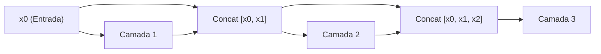

# 🌐 DenseNet (2017) — Conexões Densas e Reuso Massivo de Características

> **Artigo Original:** *Densely Connected Convolutional Networks*  
> **Autores:** Gao Huang, Zhuang Liu, Laurens van der Maaten, Kilian Q. Weinberger (Cornell University)  
> **Conferência:** CVPR 2017 (Best Paper Award)  
> **Código Didático:** [`models/densenet.py`](../models/densenet.py)

---

## 1. Contexto Histórico e A Ideia Central

Se a ResNet (2015) descobriu que conectar camadas anteriores via **soma aditiva** ($x + F(x)$) melhora drasticamente a circulação de gradientes, a **DenseNet** levou essa hipótese ao extremo lógico com uma pergunta provocativa:
> *"Em vez de somar os mapas de características (o que combina e modifica a informação original), por que não CONCATENAR diretamente todas as camadas anteriores com todas as camadas posteriores?"*

Na DenseNet, cada camada recebe como entrada os mapas de ativação de **todas as camadas precedentes** e repassa seus próprios mapas de ativação para todas as camadas subsequentes dentro de um bloco:
$$x_l = H_l([x_0, x_1, x_2, \dots, x_{l-1}])$$
onde $[x_0, x_1, \dots]$ representa a concatenação dos tensores ao longo do eixo dos canais (`dim=1`).



---

## 2. Pilares Conceituais da DenseNet

### 2.1 Reuso Massivo de Atributos (*Feature Reuse*)
Em uma CNN tradicional, uma camada profunda que precise de uma informação de contraste ou borda simples (calculada lá no início da rede) precisa propagá-la através de sucessivas convoluções, correndo o risco de atenuá-la. Na DenseNet, camadas intermediárias e profundas têm **acesso direto e desobstruído** aos filtros de baixa granularidade gerados no início.

### 2.2 Taxa de Crescimento (*Growth Rate*, $k$)
Como cada camada tem à sua disposição a riqueza de todos os mapas gerados antes dela, ela não precisa ser larga. Cada camada individual produz apenas uma quantidade minúscula de novos canais, chamada de **Taxa de Crescimento ($k$)** (tipicamente $k = 32$).
- Camada 1 produz 32 novos canais.
- Camada 2 produz 32 novos canais.
- E assim por diante.
Isso torna a DenseNet muito eficiente em número de parâmetros.

### 2.3 Camadas de Transição (*Transition Layers*)
Como a concatenação contínua aumentaria indefinidamente o número de canais, a rede é dividida em blocos densos intercalados por **Camadas de Transição**. Uma camada de transição aplica:
1. Convolução $1 \times 1$ com **fator de compressão** $\theta = 0.5$ (reduzindo pela metade a quantidade de canais acumulados).
2. Average Pooling $2 \times 2$ com stride 2 (reduzindo a resolução espacial pela metade).

---

## 3. Dissecando o Código em `models/densenet.py`

O arquivo [`models/densenet.py`](../models/densenet.py) organiza a arquitetura em três blocos modulares:

### 3.1 `DenseLayer`: O Bottleneck com Concatenação
A camada [`DenseLayer`](../models/densenet.py#L30-L55) segue o padrão pré-ativação BN-ReLU-Conv:
1. `Conv2d(in_channels, 4 * growth_rate, kernel_size=1)`: Comprime a entrada densa para evitar custo excessivo na convolução subsequente.
2. `Conv2d(4 * growth_rate, growth_rate, kernel_size=3, padding=1)`: Produz exatamente $k$ novos canais.
3. Concatenação no forward:
```python
# Trecho de models/densenet.py:
def forward(self, x: torch.Tensor) -> torch.Tensor:
    out = self.layer(x)
    # Concatena a entrada original com os novos k canais ao longo do eixo de canais (dim=1)
    return torch.cat([x, out], dim=1)
```

### 3.2 `DenseBlock` e `TransitionLayer`
- O [`DenseBlock`](../models/densenet.py#L57-L75) encadeia $N$ camadas `DenseLayer`, atualizando progressivamente a variável `channels += growth_rate`.
- O [`TransitionLayer`](../models/densenet.py#L77-L92) comprime os canais acumulados:
```python
# Compressão dos canais na transição:
out_trans = int(num_features * compression)  # Ex: theta = 0.5
```

### 3.3 A Configuração Clássica da `DenseNet-121`
No construtor [`densenet121`](../models/densenet.py#L159-L162), a rede é parametrizada com:
- `growth_rate = 32`
- `block_config = (6, 12, 24, 16)`: Significa 6 camadas no 1º bloco, 12 no 2º, 24 no 3º e 16 no 4º bloco.
- `num_init_features = 64`

---

## 4. Relevância em Radiografias de Tórax

1. **A Arquitetura Consagrada pelo CheXNet:**
   Em 2017, pesquisadores de Stanford publicaram o célebre artigo *CheXNet*, demonstrando pela primeira vez desempenho competitivo com radiologistas na detecção de pneumonia em Raio-X. O modelo escolhido como espinha dorsal foi precisamente a **DenseNet-121**.
2. **Excelente para Conjuntos Médicos Pequenos:**
   Como a DenseNet reusa características continuamente e possui conexões diretas entre todas as camadas, ela mitiga o risco de overfitting quando o conjunto de treinamento clínico conta com apenas algumas centenas ou poucos milhares de exames radiográficos.

---

## 5. Como Instanciar e Testar

```python
import torch
from models.densenet import densenet121, minidensenet

# 1. Instanciar a DenseNet-121 clássica
model = densenet121(num_classes=1, in_channels=3)

# 2. Testar com um tensor simulado de radiografia
x = torch.randn(2, 3, 224, 224)
logits = model(x)

print("Formato da saída:", logits.shape)  # torch.Size([2, 1])
```
