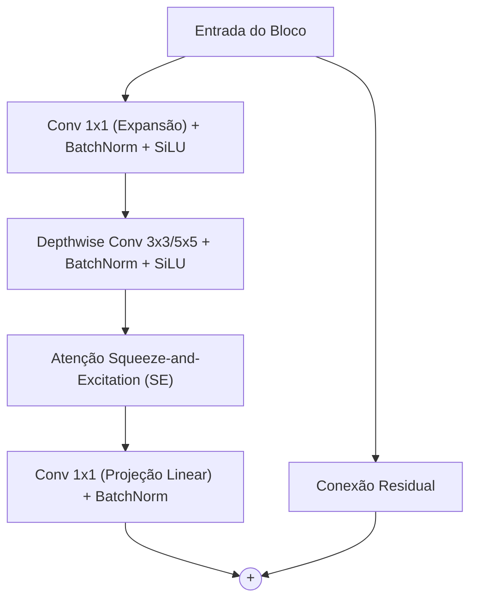

# 🚀 EfficientNet (2019) — O Escalonamento Composto e a Atenção por Canais (SE)

> **Artigo Original:** *EfficientNet: Rethinking Model Scaling for Convolutional Neural Networks*  
> **Autores:** Mingxing Tan, Quoc V. Le (Google Research)  
> **Conferência:** ICML 2019  
> **Código Didático:** [`models/efficientnet.py`](../models/efficientnet.py)

---

## 1. Contexto Histórico e O Problema

Historicamente, quando os engenheiros queriam aumentar a precisão de uma rede convolucional, eles **escalavam arbitrariamente apenas UMA das três dimensões** possíveis:

1. **Apenas Profundidade ($d$ - Depth):** Adicionar mais camadas (ex: ResNet-18 $\to$ ResNet-152).
   - *Problema:* Redes excessivamente profundas sofrem com saturação de gradientes e rendimentos decrescentes.
2. **Apenas Largura ($w$ - Width):** Aumentar o número de canais por camada (ex: WideResNet).
   - *Problema:* Redes muito largas e rasas têm dificuldade em aprender representações hierárquicas complexas.
3. **Apenas Resolução ($r$ - Resolution):** Alimentar a rede com imagens de resolução mais alta (ex: $224 \to 480$ pixels).
   - *Problema:* O custo de operações cresce quadraticamente ($O(r^2)$) e o ganho de acurácia satura rapidamente.

---

## 2. A Inovação Teórica: Escalonamento Composto (*Compound Scaling*)

Tan & Le demonstraram empiricamente que **essas três dimensões são profundamente interdependentes**:
- Se a resolução da imagem é ampliada ($r \uparrow$), a rede precisa de mais camadas ($d \uparrow$) para que o campo receptivo continue cobrindo as estruturas anatômicas inteiras.
- Ao mesmo tempo, precisa de mais canais ($w \uparrow$) para capturar padrões mais granulares com fidelidade.

O artigo formulou a **Lei do Escalonamento Composto**:
$$\text{Profundidade: } d = \alpha^\phi$$
$$\text{Largura: } w = \beta^\phi$$
$$\text{Resolução: } r = \gamma^\phi$$
$$\text{sujeito a: } \alpha \cdot \beta^2 \cdot \gamma^2 \approx 2 \quad (\alpha \ge 1, \beta \ge 1, \gamma \ge 1)$$

Onde $\phi$ é um coeficiente definido pelo usuário correspondente aos recursos computacionais disponíveis. Quando $\phi$ dobra, a capacidade da rede cresce harmonicamente nas três dimensões.

---

## 3. O Bloco Construtor: MBConv com Squeeze-and-Excitation (SE)

O bloco básico da EfficientNet é o **MBConv** (Mobile Inverted Bottleneck), enriquecido com um mecanismo de auto-atenção sobre os canais:



### 3.1 Como Funciona o Squeeze-and-Excitation (SE)?
Nem todos os canais de características têm a mesma relevância clínica em um Raio-X. O bloco SE recalibra a importância de cada canal em 3 passos:
1. **Squeeze (Compressão Espacial):**
   Aplica um `AdaptiveAvgPool2d(1)`, transformando o tensor espacial $[B, C, H, W]$ em um resumo global $[B, C, 1, 1]$.
2. **Excitation (Geração de Pesos Adaptativos):**
   Passa o vetor por um pequeno gargalo MLP com ativação `SiLU` e finaliza em uma `Sigmoid()`. A saída é um vetor de pesos entre $0$ e $1$ para cada canal.
3. **Scale (Multiplicação):**
   Multiplica cada mapa de características pelo seu respectivo peso aprendido. A rede aprende a **amplificar canais com achados patológicos** e **suprimir canais com artefatos de ruído**.

### 3.2 A Função de Ativação SiLU (Swish)
Substitui a ReLU tradicional por:
$$\text{SiLU}(x) = x \cdot \sigma(x) = \frac{x}{1 + e^{-x}}$$
Diferente da ReLU, a SiLU é estritamente suave e não-monótona, permitindo que pequenos valores negativos fluam gradientes sutis durante o treinamento.

---

## 4. Dissecando o Código em `models/efficientnet.py`

O arquivo [`models/efficientnet.py`](../models/efficientnet.py) implementa:

### 4.1 O Bloco SE: `SqueezeExcitation`
No código de [`models/efficientnet.py`](../models/efficientnet.py#L40-L58):
```python
# Trecho didático de models/efficientnet.py:
class SqueezeExcitation(nn.Module):
    def __init__(self, in_channels: int, reduced_dim: int):
        super().__init__()
        self.se = nn.Sequential(
            nn.AdaptiveAvgPool2d(1),                     # Squeeze
            nn.Conv2d(in_channels, reduced_dim, 1),      # Redução
            nn.SiLU(inplace=True),
            nn.Conv2d(reduced_dim, in_channels, 1),      # Expansão
            nn.Sigmoid()                                 # Pesos entre [0, 1]
        )

    def forward(self, x: torch.Tensor) -> torch.Tensor:
        scale = self.se(x)
        return x * scale  # Scale
```

### 4.2 A Arquitetura `EfficientNet` (Baseline B0)
A classe [`EfficientNet`](../models/efficientnet.py#L122-L190) implementa a configuração canônica da **EfficientNet-B0**, que serve de base para todo o escalonamento composto:
- Stem inicial com 32 canais e ativação SiLU.
- 7 estágios MBConv com combinações de filtros $3 \times 3$ e $5 \times 5$, expansão de 1x e 6x, e atenção SE.
- Head convolucional de expansão para 1280 canais com `AdaptiveAvgPool2d((1, 1))` e projeção linear.

---

## 5. Relevância em Radiografias de Tórax

1. **Supressão de Artefatos Externos:**
   Radiografias de pacientes hospitalizados comumente possuem fios de eletrodos, cateteres, tubos endotraqueais ou marcapassos. O mecanismo Squeeze-and-Excitation aprende dinamicamente a ignorar os canais que reagem a esses artefatos metálicos e a focar nos canais anatômicos pulmonares.
2. **Eficiência de VRAM em Batch Sizes Maiores:**
   A EfficientNet-B0 atinge acurácia superior à ResNet-50 consumindo uma fração da memória de vídeo, permitindo treinar lotes maiores em GPUs menores.

---

## 6. Como Instanciar e Testar

```python
import torch
from models.efficientnet import efficientnet_b0, EfficientNet

# 1. Instanciar a EfficientNet-B0 didática
model = efficientnet_b0(num_classes=1, in_channels=3)

# 2. Testar o fluxo de tensores com radiografia simulada
x = torch.randn(2, 3, 224, 224)
output = model(x)

print("Saída da EfficientNet-B0:", output.shape)  # torch.Size([2, 1])
```
