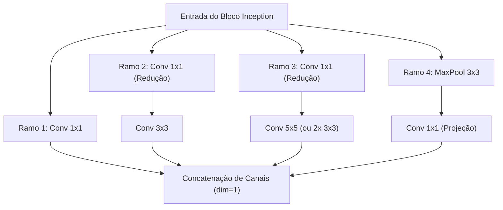

# 🔬 Inception / GoogLeNet (2014-2015) — Processamento Paralelo Multi-Escala

> **Artigo Original:** *Going Deeper with Convolutions*  
> **Autores:** Christian Szegedy et al. (Google Research)  
> **Conferência:** CVPR 2015 (Vencedora do ILSVRC 2014)  
> **Código Didático:** [`models/inception.py`](../models/inception.py)

---

## 1. Contexto Histórico: O Dilema do Tamanho do Kernel

Ao projetar uma rede neural convolucional para imagens reais, o projetista enfrenta uma dúvida recorrente:
> *"Qual tamanho de filtro convolucional devo escolher para esta camada? 1x1, 3x3 ou 5x5?"*

- **Filtros $1 \times 1$:** Capturam correlações pontuais entre canais de densidade sem misturar informações espaciais vizinhas.
- **Filtros $3 \times 3$:** Capturam padrões locais médios (arestas, contornos de pequenas estruturas).
- **Filtros $5 \times 5$:** Capturam informações contextuais amplas de áreas maiores da imagem.

Em imagens médicas de **Raio-X de Tórax**, essa dúvida é particularmente crítica:
- Uma calcificação ou nódulo pulmonar precoce exige resolução focal finíssima ($3 \times 3$ ou menor).
- O contorno da silhueta cardíaca (para avaliar cardiomegalia) ou um derrame pleural volumoso exige campo visual amplo ($5 \times 5$ ou maior).

A resposta proposta pela equipe da Google foi inovadora:
**"Não escolha um único tamanho de kernel: execute TODOS em paralelo e concatene suas saídas!"**

---

## 2. A Arquitetura do Bloco Inception



### 2.1 O Papel Crítico das Convoluções $1 \times 1$ como Gargalos (*Bottlenecks*)
Executar uma convolução $5 \times 5$ diretamente sobre um tensor com centenas de canais seria computacionalmente proibitivo.

Considere uma entrada com 192 canais e saída com 32 canais usando filtro $5 \times 5$:
- **Sem redução $1 \times 1$:**
  $$\text{FLOPs} = H \times W \times (5 \times 5 \times 192 \times 32) = 153.600 \times H \times W$$
- **Com redução $1 \times 1$ prévia para 16 canais:**
  1. Conv $1 \times 1$ ($192 \to 16$): $H \times W \times (1 \times 1 \times 192 \times 16) = 3.072 \times H \times W$
  2. Conv $5 \times 5$ ($16 \to 32$): $H \times W \times (5 \times 5 \times 16 \times 32) = 12.800 \times H \times W$
  - **Total:** $15.872 \times H \times W$ (**redução de quase $10\times$ no custo de operações!**).

A convolução $1 \times 1$ atua comprimindo a dimensão de canais antes que o filtro espacial pesado processe a informação.

---

## 3. Dissecando o Código em `models/inception.py`

No arquivo [`models/inception.py`](../models/inception.py), a implementação é composta por:

### 3.1 `InceptionBlock` (Os 4 Ramos Paralelos)
O [`InceptionBlock`](../models/inception.py#L47-L93) constrói os quatro caminhos paralelos:

```python
# Trecho de models/inception.py:
def forward(self, x: torch.Tensor) -> torch.Tensor:
    out1 = self.branch1(x)  # Conv 1x1
    out2 = self.branch2(x)  # Conv 1x1 -> Conv 3x3
    out3 = self.branch3(x)  # Conv 1x1 -> Duas Convs 3x3 (estilo Inception-v3)
    out4 = self.branch4(x)  # MaxPool 3x3 -> Conv 1x1

    # Concatenação de todos os ramos ao longo do eixo de canais (dim=1)
    return torch.cat([out1, out2, out3, out4], dim=1)
```

> **Nota Didática:** No ramo 3, usamos duas convoluções $3 \times 3$ consecutivas em vez de uma $5 \times 5$ pura, aplicando a regra de equivalência de campo receptivo introduzida pela VGG e adotada no Inception-v3.

### 3.2 `InceptionNet`
A rede [`InceptionNet`](../models/inception.py#L95-L141) é estruturada em:
1. **Stem Convolucional:** Reduz a resolução espacial inicial com Convs $7 \times 7$ e $3 \times 3$ seguidas de MaxPoolings.
2. **Estágio Inception 3 e 4:** Dois pares de módulos Inception empilhados.
3. **Classificador:** `AdaptiveAvgPool2d((1, 1))` com `Dropout(0.4)` e projeção linear.

---

## 4. Relevância em Radiografias de Tórax

1. **Alvos Clínicos em Escalas Espaciais Disparatadas:**
   Um exame de tórax reúne simultaneamente alterações microscópicas (nódulos de poucos milímetros, espessamento da trama peribroncovascular) e alterações macroscópicas (aumento das câmaras cardíacas, atelectasias lobares completas). O Inception processa essas diferentes resoluções em paralelo.
2. **Eficiência de Parâmetros:**
   O GoogLeNet original continha apenas ~7 milhões de parâmetros (cerca de 20x menos que a AlexNet e 19x menos que a VGG-16), permitindo um treinamento mais estável em máquinas modestas.

---

## 5. Como Instanciar e Testar

```python
import torch
from models.inception import inception, InceptionNet

# 1. Instanciar a InceptionNet didática
model = inception(num_classes=1, in_channels=3)

# 2. Testar o fluxo de tensores com imagem médica
x = torch.randn(2, 3, 224, 224)
output = model(x)

print("Saída do Inception:", output.shape)  # torch.Size([2, 1])
```
