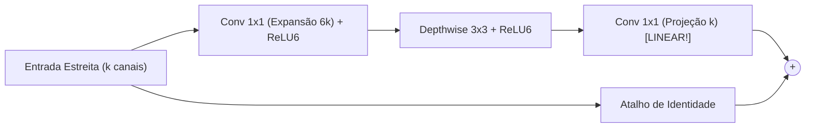

# 📱 MobileNet (v1 - 2017 & v2 - 2018) — Eficiência Extrema em Dispositivos Móveis

> **Artigos Originais:**  
> - v1: *MobileNets: Efficient Convolutional Neural Networks for Mobile Vision Applications* (Howard et al., 2017)  
> - v2: *MobileNetV2: Inverted Residuals and Linear Bottlenecks* (Sandler et al., 2018)  
> **Autores:** Google Research  
> **Código Didático:** [`models/mobilenet.py`](../models/mobilenet.py)

---

## 1. Contexto Histórico e O Problema

Até 2017, os avanços em acurácia no ImageNet vinham acompanhados de redes cada vez mais pesadas, exigindo bilhões de operações de ponto flutuante (FLOPs) e placas de vídeo de alta potência. 

Isso inviabilizava a execução de inteligência artificial em:
- Smartphones e tablets hospitalares.
- Aparelhos portáteis de Raio-X em UTIs ou ambulâncias de emergência (*Point-of-Care Testing*).
- Sistemas embarcados sem conexão constante com servidores em nuvem.

A família **MobileNet** foi concebida para responder à pergunta:
> *"Como manter alta acurácia diagnóstica reduzindo drasticamente o consumo computacional, o uso de memória RAM e a bateria do dispositivo?"*

---

## 2. Inovações Teóricas da MobileNet

### 2.1 MobileNetV1: Convolução Separável em Profundidade (*Depthwise Separable Conv*)
Uma convolução $2D$ convencional realiza simultaneamente duas tarefas computacionalmente caras:
1. **Filtragem Espacial:** Varre a imagem ao longo das dimensões de altura e largura ($H \times W$).
2. **Combinação de Canais:** Combina os atributos entre os diferentes canais ($C$).

A Convolução Separável decompõe essa operação em duas etapas independentes:
1. **Depthwise Convolution:** Aplica um único filtro espacial $3 \times 3$ por canal de entrada individualmente, sem cruzar informações entre canais (`groups = in_channels`).
2. **Pointwise Convolution:** Aplica uma convolução $1 \times 1$ convencional para recombinar linearmente os canais projetando para a dimensão de saída.

```text
Custo de uma Convolução Padrão:
    Custo = D_K * D_K * M * N * D_F * D_F

Custo da Convolução Separável em Profundidade:
    Custo = (D_K * D_K * M * D_F * D_F) + (M * N * D_F * D_F)

Razão de Economia = 1/N + 1/(D_K^2)
Para kernels 3x3 (D_K = 3), a economia é de aproximadamente 8x a 9x menos operações matemáticas!
```

---

### 2.2 MobileNetV2: Resíduos Invertidos e Gargalos Lineares

A versão 2 trouxe duas rupturas conceituais em relação à ResNet tradicional:



1. **Resíduos Invertidos (*Inverted Residuals*):**
   - Na ResNet clássica: canais **largos** $\to$ comprime para **estreitos** (bottleneck) $\to$ expande para **largos**. O atalho conecta os estados de alta dimensão.
   - Na MobileNetV2: os atalhos conectam os **espaços estreitos** (economizando tráfego de memória cache na CPU/GPU). A expansão interna (fator de expansão $6\times$) ocorre apenas internamente no bloco.
2. **Gargalo Linear (*Linear Bottleneck*):**
   - A última camada $1 \times 1$ do bloco **não possui ativação ReLU**.
   - **Justificativa Matemática:** Os autores provaram que aplicar ReLU (que zera todos os números negativos) em espaços estreitos de baixa dimensionalidade causa perda irreversível de informação e colapsa a variedade matemática (*manifold collapse*).
3. **Ativação ReLU6:**
   $$\text{ReLU6}(x) = \min(\max(0, x), 6)$$
   Limitar o teto de ativação em $6$ facilita a quantização numérica em ponto fixo (como inteiros de 8 bits - `INT8`), permitindo que a rede rode com altíssima velocidade em processadores de baixo custo.

---

## 3. Dissecando o Código em `models/mobilenet.py`

O arquivo [`models/mobilenet.py`](../models/mobilenet.py) contém as implementações completas de ambos os blocos e modelos.

### 3.1 Bloco `DepthwiseSeparableConv` (MobileNetV1)
No código de [`models/mobilenet.py`](../models/mobilenet.py#L42-L77), note o argumento `groups=in_channels` que transforma a convolução padrão em Depthwise:

```python
# Trecho didático de models/mobilenet.py:
self.block = nn.Sequential(
    # 1. Depthwise Convolution (groups = in_channels)
    nn.Conv2d(in_channels, in_channels, kernel_size=3, stride=stride, padding=1, groups=in_channels, bias=False),
    nn.BatchNorm2d(in_channels),
    nn.ReLU(inplace=True),

    # 2. Pointwise Convolution 1x1
    nn.Conv2d(in_channels, out_channels, kernel_size=1, stride=1, bias=False),
    nn.BatchNorm2d(out_channels),
    nn.ReLU(inplace=True)
)
```

### 3.2 Bloco `InvertedResidual` (MobileNetV2)
No bloco [`InvertedResidual`](../models/mobilenet.py#L79-L126), veja o detalhe do gargalo linear na última projeção:

```python
# 1. Expansão 1x1 (se expand_ratio != 1)
layers.extend([
    nn.Conv2d(in_channels, hidden_dim, kernel_size=1, bias=False),
    nn.BatchNorm2d(hidden_dim),
    nn.ReLU6(inplace=True)
])

# 2. Depthwise Conv 3x3
layers.extend([
    nn.Conv2d(hidden_dim, hidden_dim, kernel_size=3, stride=stride, padding=1, groups=hidden_dim, bias=False),
    nn.BatchNorm2d(hidden_dim),
    nn.ReLU6(inplace=True)
])

# 3. Projeção Pointwise 1x1 (LINEAR! Sem ativação no final)
layers.extend([
    nn.Conv2d(hidden_dim, out_channels, kernel_size=1, bias=False),
    nn.BatchNorm2d(out_channels)
])
```

---

## 4. Relevância em Radiografias de Tórax

1. **Aparelhos Portáteis de Raio-X:**
   Em situações de catástrofe, hospitais de campanha ou triagem rápida de COVID-19/pneumonia em unidades remotas, as MobileNets permitem embarcar o classificador em equipamentos leves sem necessidade de conexão com a internet.
2. **Latência Mínima para Triagem:**
   O tempo de inferência por imagem é de apenas alguns milissegundos, viabilizando o processamento de grandes filas de exames em tempo real.

---

## 5. Como Instanciar e Testar

```python
import torch
from models.mobilenet import mobilenet_v1, mobilenet_v2

# 1. Instanciar a MobileNetV2 para classificação binária
model = mobilenet_v2(num_classes=1, in_channels=3)

# 2. Testar o forward com uma radiografia simulada
x = torch.randn(2, 3, 224, 224)
saida = model(x)

print("Saída da MobileNetV2:", saida.shape)  # torch.Size([2, 1])
```
