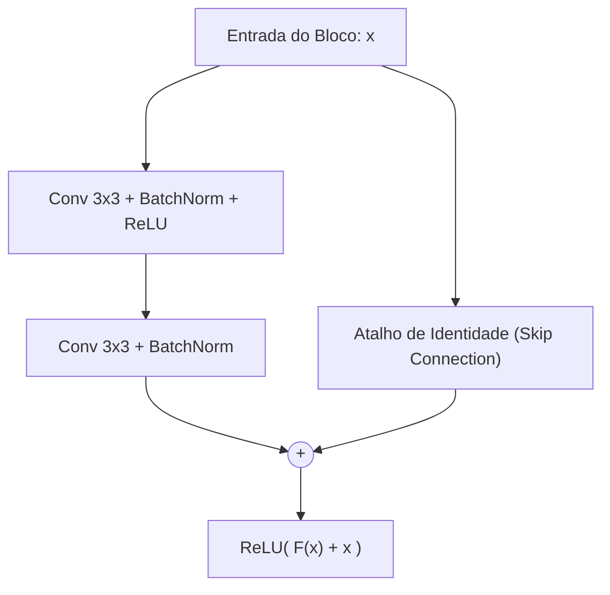

# ⚡ ResNet (2015) — O Fim da Degradação e o Aprendizado Residual

> **Artigo Original:** *Deep Residual Learning for Image Recognition*  
> **Autores:** Kaiming He, Xiangyu Zhang, Shaoqing Ren, Jian Sun (Microsoft Research)  
> **Conferência:** CVPR 2016 (Vencedora do ILSVRC 2015, Best Paper Award)  
> **Código Didático:** [`models/resnet.py`](../models/resnet.py)

---

## 1. Contexto Histórico: O Problema de Degradação

Após a consagração da VGG, a intuição natural dos pesquisadores era: *"Se uma rede de 16 camadas é melhor que uma de 8, uma rede de 56 camadas será muito melhor"*. 

Contudo, ao construir redes convolucionais profundas tradicionais (empilhamento direto de camadas), ocorreu uma surpresa amarga: **o erro de treino subia consideravelmente em redes mais profundas**.

```text
Paradoxo da Degradação (He et al., 2015):
Erro de Treino:
^
|       /---- Rede de 56 camadas (Pior!)
|      /
|     /------ Rede de 20 camadas (Melhor!)
|
+-----------------------------------> Épocas
```

> **Atenção Didática:** Isso **NÃO** era *overfitting*. Se fosse overfitting, o erro de treino seria quase zero e apenas o erro de teste subiria. Na degradação, o próprio erro de treino era pior! O problema residia na **dificuldade de otimização**: conforme os gradientes retropropagavam por dezenas de camadas através da regra da cadeia, sucessivas multiplicações de matrizes faziam com que o gradiente desaparecesse exponencialmente (*Vanishing Gradient*).

---

## 2. A Solução: Aprendizado Residual ($H(x) = F(x) + x$)

Kaiming He e seus colegas propuseram uma mudança conceitual genial: em vez de esperar que um conjunto de camadas aprenda diretamente o mapeamento ideal $H(x)$, a rede deve aprender apenas a **função residual** $F(x) = H(x) - x$.

A formulação original torna-se:
$$H(x) = F(x) + x$$



### 2.1 Por que o Gradiente Não Some? A Matemática da "Super-Rodovia"
Vamos aplicar a derivada da função de perda $\mathcal{L}$ em relação à entrada do bloco $x$, utilizando a regra da cadeia:
$$\frac{\partial \mathcal{L}}{\partial x} = \frac{\partial \mathcal{L}}{\partial H} \cdot \frac{\partial H}{\partial x} = \frac{\partial \mathcal{L}}{\partial H} \cdot \frac{\partial (F(x) + x)}{\partial x}$$

$$\frac{\partial \mathcal{L}}{\partial x} = \frac{\partial \mathcal{L}}{\partial H} \cdot \left( \frac{\partial F(x)}{\partial x} + 1 \right)$$

Ao expandir o produto:
$$\frac{\partial \mathcal{L}}{\partial x} = \frac{\partial \mathcal{L}}{\partial H} \cdot \frac{\partial F(x)}{\partial x} + \frac{\partial \mathcal{L}}{\partial H}$$

Observe com atenção o termo **$\mathbf{+ \frac{\partial \mathcal{L}}{\partial H}}$**:
Mesmo que as convoluções intermediárias $\frac{\partial F(x)}{\partial x}$ se aproximem de zero, o gradiente $\frac{\partial \mathcal{L}}{\partial H}$ **flui diretamente intacto e sem nenhuma multiplicação atenuante** através do atalho de identidade até as camadas mais rasas da rede! Isso permitiu treinar redes estáveis com 100, 152 e até mais de 1.000 camadas.

---

## 3. Dissecando o Código em `models/resnet.py`

O arquivo [`models/resnet.py`](../models/resnet.py) implementa os dois blocos construtores que sustentam toda a família ResNet.

### 3.1 `BasicBlock` (ResNet-18 e ResNet-34)
O [`BasicBlock`](../models/resnet.py#L28-L100) é composto por duas convoluções $3 \times 3$ com `BatchNorm2d` e `ReLU`:

```python
# Trecho de models/resnet.py:
def forward(self, x: torch.Tensor) -> torch.Tensor:
    identity = x

    out = self.conv1(x)
    out = self.bn1(out)
    out = self.relu(out)

    out = self.conv2(out)
    out = self.bn2(out)

    if self.downsample is not None:
        identity = self.downsample(identity)

    # Conexão Residual: F(x) + x
    out = out + identity
    out = self.relu(out)
    return out
```

### 3.2 `Bottleneck` (ResNet-50, ResNet-101 e ResNet-152)
Em redes com 50 camadas ou mais, encadear duas convoluções $3 \times 3$ consecutivas torna-se computacionalmente oneroso. O bloco [`Bottleneck`](../models/resnet.py#L102-L182) adota a estratégia de três etapas:
1. **Conv $1 \times 1$:** Reduz a dimensão de canais (ex: $256 \to 64$).
2. **Conv $3 \times 3$:** Executa a filtragem espacial com custo computacional comprimido.
3. **Conv $1 \times 1$:** Expande os canais de volta por um fator de 4 ($64 \to 256$, `expansion = 4`).

### 3.3 A Classe Geral `ResNet` e `_make_layer`
A classe [`ResNet`](../models/resnet.py#L184-L247) divide o processamento em:
1. **Stem:** Convolução $7 \times 7$ com $\text{stride} = 2$ e `MaxPool2d(3, stride=2)`, reduzindo a resolução de entrada por $4\times$.
2. **4 Estágios Residuais:** Construídos via `_make_layer`. O primeiro bloco de cada estágio é responsável por aplicar $\text{stride} = 2$ e projeção $1 \times 1$ no atalho caso haja redução espacial.
3. **Cabeçote Final:** `AdaptiveAvgPool2d((1, 1))` seguido por uma camada `nn.Linear` que projeta para `num_classes`.

---

## 4. Relevância em Radiografias de Tórax

1. **O Baseline Padrão da Literatura Médica:**
   A ResNet (em particular a **ResNet-18** e a **ResNet-50**) é a arquitetura mais recomendada como primeiro experimento em exames de imagem médica: seu comportamento de otimização é extremamente confiável e raramente sofre instabilidade de gradiente.
2. **Camadas Residuais Preservam Detalhes Finos:**
   Em um Raio-X de tórax, anomalias sutis (como pequenos nódulos pulmonares ou perda sutil do contorno do seio costofrênico) não se perdem nas camadas mais profundas porque as conexões de identidade mantêm o fluxo de sinal primitivo disponível ao longo de toda a rede.

---

## 5. Como Instanciar e Testar

```python
import torch
from models.resnet import resnet18, resnet50, ResNet

# 1. Instanciar a ResNet-18 para classificação binária de Raio-X
model = resnet18(num_classes=1, in_channels=3)

# 2. Entrada simulada [Batch=2, Canais=3, H=224, W=224]
x = torch.randn(2, 3, 224, 224)
logits = model(x)

print("Formato dos logits:", logits.shape)  # torch.Size([2, 1])
```
