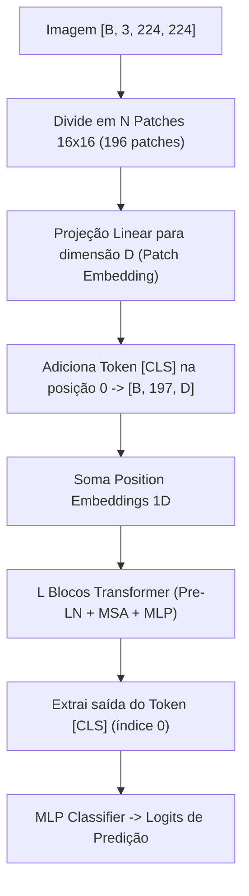

# 👁️ Vision Transformer — ViT (2020) — A Quebra do Paradigma Convolucional

> **Artigo Original:** *An Image is Worth 16x16 Words: Transformers for Image Recognition at Scale*  
> **Autores:** Alexey Dosovitskiy et al. (Google Research, Brain Team)  
> **Conferência:** ICLR 2021  
> **Código Didático:** [`models/vision_transformer.py`](../models/vision_transformer.py)

---

## 1. A Ruptura de Paradigma: O Fim do Monopólio das Convoluções

Durante quase uma década (2012–2020), o campo da Visão Computacional foi regido exclusivamente por Redes Convolucionais (CNNs). As convoluções trazem em sua formulação matemática um forte **Viés Indutivo (*Inductive Bias*)**:
1. **Localidade 2D:** Assume previamente que pixels vizinhos estão fortemente correlacionados e que pixels distantes têm pouca relação imediata.
2. **Equivariância à Translação:** Assume que um padrão visual (como uma borda ou uma textura) tem exatamente o mesmo significado em qualquer canto da imagem ($f(g(x)) = g(f(x))$).

O Vision Transformer quebrou essa premissa com uma aposta revolucionária:
> *"E se jogássemos fora todo o viés indutivo convolucional e tratássemos a imagem simplesmente como uma frase de texto, aplicando o mecanismo de Auto-Atenção pura do Transformer original (Vaswani et al., 2017)?"*

Sem saber a priori que pixels formam uma grade 2D, o modelo precisa **aprender a geometria do espaço visual inteiramente a partir dos dados**.

---

## 2. Como uma Imagem 2D se Torna uma Sequência de "Palavras"?



### 2.1 Patch Partition e Patch Embedding
Uma imagem de dimensões $H \times W$ e $C$ canais é dividida em uma grade de pequenos blocos (*patches*) não sobrepostos de tamanho $P \times P$ (ex: $16 \times 16$).
O número total de patches $N$ gerados é:
$$N = \frac{H \cdot W}{P^2}$$
Para uma imagem médica $224 \times 224$ com patches $16 \times 16$:
$$N = \frac{224 \times 224}{16 \times 16} = 14 \times 14 = 196 \text{ patches}$$

Cada patch achatado (com $16 \times 16 \times 3 = 768$ valores numéricos) é projetado linearmente para uma dimensão latente contínua $D$ através de uma matriz de pesos aprendível.

### 2.2 O Token Especial de Classificação (`[CLS]`)
Inspirado no modelo BERT de Processamento de Linguagem Natural, um vetor aprendível especial chamado `[CLS]` (dimensão $1 \times D$) é inserido na primeira posição da sequência (índice 0). A sequência passa a ter comprimento $N + 1$ ($197$ tokens). 

Como todas as posições interagem entre si através da auto-atenção, ao final das camadas o estado desse token sintetizou a informação semântica global da radiografia e é utilizado diretamente pelo classificador final.

### 2.3 Codificação Posicional 1D (*Position Embeddings*)
O mecanismo de auto-atenção pura é **invariante à permutação** (ele não sabe a ordem dos tokens). Para que o modelo saiba onde cada fragmento da imagem estava localizado (canto superior, centro, borda inferior), vetores aprendíveis de posição 1D são **somados** elemento a elemento a cada token da sequência.

### 2.4 Auto-Atenção Multi-Cabeça (*Multi-Head Self-Attention - MSA*)
Permite que cada pedaço da imagem olhe para qualquer outro pedaço simultaneamente desde a primeiríssima camada:
$$\text{Attention}(Q, K, V) = \text{softmax}\left( \frac{Q K^T}{\sqrt{d_k}} \right) V$$
Onde:
- **$Q$ (Query):** O que este patch está procurando?
- **$K$ (Key):** Qual informação este patch contém?
- **$V$ (Value):** O conteúdo informacional real do patch.
- **$\sqrt{d_k}$:** Fator de escalonamento para evitar saturação do softmax.

---

## 3. Dissecando o Código em `models/vision_transformer.py`

O arquivo [`models/vision_transformer.py`](../models/vision_transformer.py) implementa o ViT modularmente:

### 3.1 `PatchEmbedding` via Convolução Eficiente
No código de [`models/vision_transformer.py`](../models/vision_transformer.py#L39-L62), a divisão e projeção linear é implementada de forma elegante através de um `Conv2d` com `kernel_size=patch_size` e `stride=patch_size`:

```python
# Trecho de models/vision_transformer.py:
class PatchEmbedding(nn.Module):
    def __init__(self, img_size: int = 224, patch_size: int = 16, in_channels: int = 3, embed_dim: int = 768):
        super().__init__()
        self.proj = nn.Conv2d(
            in_channels=in_channels,
            out_channels=embed_dim,
            kernel_size=patch_size,
            stride=patch_size
        )

    def forward(self, x: torch.Tensor) -> torch.Tensor:
        # [B, C, H, W] -> [B, embed_dim, H/P, W/P] -> flatten -> [B, embed_dim, N] -> [B, N, embed_dim]
        x = self.proj(x)
        return x.flatten(2).transpose(1, 2)
```

### 3.2 O Mecanismo `MultiHeadSelfAttention`
Em [`models/vision_transformer.py`](../models/vision_transformer.py#L64-L101), as matrizes $Q, K, V$ são geradas em uma única projeção linear conjunta `nn.Linear(embed_dim, embed_dim * 3)` e divididas entre as cabeças de atenção:

```python
# Trecho de models/vision_transformer.py:
qkv = self.qkv(x).reshape(B, N, 3, self.num_heads, self.head_dim).permute(2, 0, 3, 1, 4)
q, k, v = qkv[0], qkv[1], qkv[2]

# Scaled Dot-Product Attention
attn = (q @ k.transpose(-2, -1)) * self.scale
attn = attn.softmax(dim=-1)
out = (attn @ v).transpose(1, 2).reshape(B, N, C)
```

### 3.3 A Classe `VisionTransformer` e Configuração `vit_tiny`
A classe [`VisionTransformer`](../models/vision_transformer.py#L142-L229) reúne:
- Inicialização do `cls_token` e `pos_embed` via `nn.init.trunc_normal_`.
- Pilha de blocos `TransformerEncoderBlock` com arquitetura Pre-LayerNorm.
- Construtor leve [`vit_tiny`](../models/vision_transformer.py#L231-L241) (`embed_dim=192`, `depth=6`, `num_heads=3`), projetado especialmente para rodar com eficiência em sala de aula.

---

## 4. Relevância em Radiografias de Tórax

1. **Correlação Anatômica Global Instantânea:**
   Em um Raio-X de tórax, radiologistas comparam rotineiramente estruturas bilaterais (ex: comparar a transparência do ápice do pulmão direito com o ápice do pulmão esquerdo). O Transformer permite que patches de lados opostos do tórax interajam de forma direta desde a primeira camada, algo que uma CNN só consegue fazer após dezenas de reduções espaciais.
2. **Dependência Crítica de Pré-Treinamento:**
   Por não possuir o viés indutivo convolucional de localidade, um Vision Transformer treinado do zero em poucos exames médicos terá dificuldade em convergir. Em aplicações reais de saúde, é fundamental utilizar pesos pré-treinados em grandes bases (via `use_timm=True` / `pretrained=True`).

---

## 5. Como Instanciar e Testar

```python
import torch
from models.vision_transformer import vit_tiny, VisionTransformer

# 1. Instanciar o ViT didático leve
model = vit_tiny(img_size=224, patch_size=16, num_classes=1)

# 2. Testar o fluxo de atenção com lote simulado de Raio-X
x = torch.randn(2, 3, 224, 224)
saida_logits = model(x)

print("Saída do Vision Transformer:", saida_logits.shape)  # torch.Size([2, 1])
```
